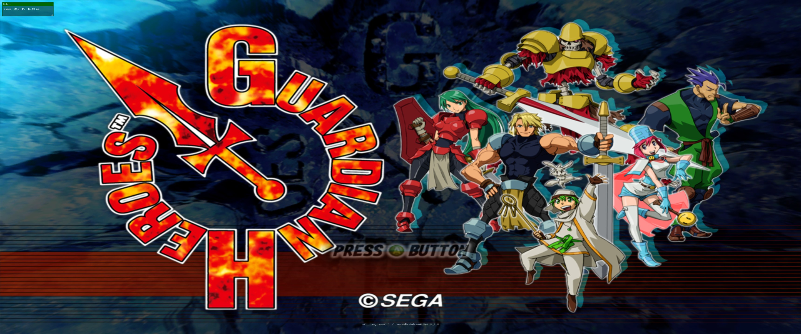
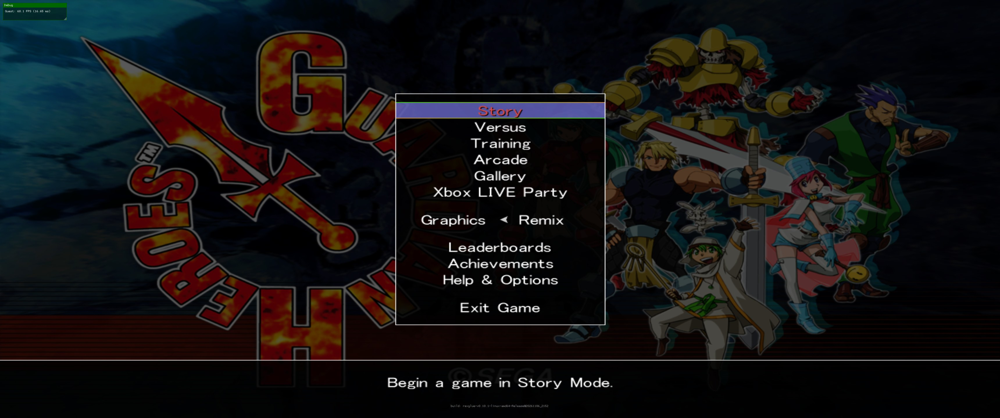
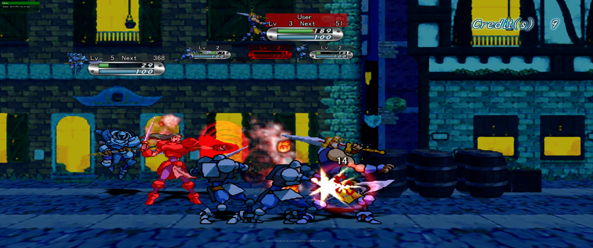
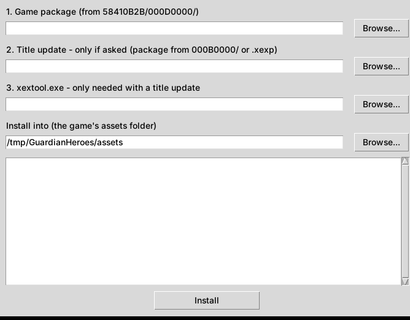

# Guardian Heroes Recomp

A native **Linux and Windows** port of **Guardian Heroes** (Xbox Live Arcade, Treasure / SEGA, 2011)
made by static recompilation with [ReXGlue](https://github.com/rexglue/rexglue-sdk). The game's
Xbox 360 PowerPC code is translated to C++ and compiled into a normal program, with Xbox 360
graphics and audio handled by ReXGlue's runtime (Vulkan on Linux, Direct3D 12 on Windows).

> **No game data is included anywhere in this project.** You need your own legally obtained copy
> of Guardian Heroes.
>
> Not affiliated with or endorsed by SEGA, Treasure or Microsoft.

<p align="center">
  
</p>
<p align="center">
  
</p>
<p align="center">
  
</p>
<p align="center"><sub>Title screen · main menu · Story mode at 2576×1078, 60 FPS on Linux (RX 6750 XT)</sub></p>

## Features

- **Native Linux and Windows builds**: no emulator to set up, just extract and run.
- **Full game**, not the Xbox Live Arcade trial: Story, Versus, Training, Arcade, Gallery, and both
  the Remix and original Saturn graphics and rules.
- **60 FPS** at any resolution, with a resolution scale up to 3x (4K).
- **Up to 4 players** on one PC: each controller is its own player, and the keyboard is player 1.
- **In-game settings menu (F1)** for graphics, sound, controls and players, with no config file
  editing needed.
- **Controller or keyboard**: any Xbox or PlayStation controller, or play on the keyboard.
- **FPS overlay (F3)** and an optional 60 fps frame limiter.
- System prompts (like "Create new game data?") are answered for you, so no mouse is needed.
- Quits properly from the game's own Exit Game option.

## Status

Tested on a Radeon RX 6750 XT on Ubuntu 26.04: boots, menus, Story mode and fights at a locked
60 FPS with audio. The Windows build is made by the same CI and is less tested; reports welcome.

If the game ever closes with `Call to invalid or unregistered function at guest address 0x…` in
the log, please open an issue with that address (see [Notes for developers](#notes-for-developers)).

## Download and play

1. Download the [latest release](../../releases/latest): **GuardianHeroes-linux-x64.tar.gz** for
   Linux or **GuardianHeroes-windows-x64.zip** for Windows, and extract it.
2. Copy your Guardian Heroes package file off your Xbox 360 (see
   [Getting your game files](#getting-your-game-files)).
3. Run the installer next to the game: **GuardianHeroes-Installer.exe** on Windows (nothing else
   needed), `./install_game.py` on Linux. Pick the package file and press **Install**. It fills the
   `assets` folder and checks the game version; if your copy needs the title update, it tells you
   and applies it.
4. Run `./guardianheroes` (Linux) or `guardianheroes.exe` (Windows). If the game files are missing
   or the wrong version, the game says so in a popup instead of crashing.

**Updating:** copy the new program and its `.so`/`.dll` files over the old ones. Keep your
`guardianheroes.toml` and `assets` folder.

### Linux

```
tar xzf GuardianHeroes-linux-x64.tar.gz
cd GuardianHeroes
# copy default.xex, ArcadeInfo.xml and the media folder into assets/
./guardianheroes
```

Requirements: 64-bit Linux with glibc 2.38 or newer (Ubuntu 24.04+, Fedora 39+, Arch, SteamOS
3.6+, ...), and a Vulkan driver (Mesa RADV for AMD, the NVIDIA driver, or Mesa ANV for Intel). The
window uses X11, so on a Wayland desktop XWayland must be available (it is by default).

### Windows

Requirements: 64-bit Windows 10/11, a DirectX 12 graphics card and a CPU with SSE4.1. The Visual
C++ runtime DLLs are included; if Windows still says `MSVCP140.dll` is missing, install the
[Microsoft Visual C++ Redistributable (x64)](https://aka.ms/vs/17/release/vc_redist.x64.exe).

## Settings menu (F1)

Press **F1** (or **LB + RB + X** on a controller, **Q + E + X** on the keyboard) to open the
settings menu. Press **Save** to keep changes; they're written to `guardianheroes.toml` next to the
game. On a controller, **LB / RB** switch tabs and **B** closes the menu.

| Tab | Settings |
|---|---|
| **Graphics & Sound** | Resolution scale (1x 720p / 2x 1440p / 3x 4K), fullscreen, vsync, frame limiter, black bars on wide screens, texture filtering, mute, menu size |
| **Controls** | Keyboard on/off and smoothing, "all controllers act as player 1", and the full list of controls |

Other keys: **F3** shows the FPS overlay, **F4** has every advanced engine setting.

## Controls

Each controller is its own player, up to 4, as on the console. On a keyboard (player 1):

| Key | Xbox button |
|---|---|
| ← → ↑ ↓ / W A S D | Move (up = jump) |
| Enter / Space / K | A |
| Backspace / L | B |
| X / J | X |
| Y / I | Y |
| Q / E | LB / RB |
| Z / C | LT / RT (lane shifts) |
| Escape / P | Start |
| Tab / R | Back |

**How to play:** Guardian Heroes plays like a 2D fighting game. Each stage has three lanes (front,
middle, back); the triggers and bumpers jump between them to dodge or get round enemies. Up jumps,
special moves and magic use fighting-game inputs, and you level up stats between stages. The game
shows its own button layout under **Help & Options**, and **Training** is the place to try moves.

## Troubleshooting

- **Stutter or uneven frame pacing** (high-refresh screens): turn on **Frame limiter** in
  F1 → Graphics & Sound.
- **"Your default.xex is version …, which this download doesn't support"**: please open an issue
  with that version number. 0.0.0.2 and 0.0.0.3 are supported.
- **Want to answer the game's own prompts** (save data, device selection) yourself: set
  `headless = false` in `guardianheroes.toml` and click the buttons with the mouse.
- **Crashes:** `crash.txt` and the newest file in the `logs` folder show what happened. Please
  attach them to an issue. For more detail set `log_level = "info"` in `guardianheroes.toml`, then
  set it back to `"warn"`.

## Getting your game files

> **Got the game package but not sure what to do with it?** [XBLA Installer](https://github.com/trev82usa/XBLA-Installer) is a standalone version of the installer (Windows .exe / Linux), handy if you want it without downloading the game build first.

This project doesn't include or link to the game. You need **your own copy of Guardian Heroes**, the
Xbox Live Arcade game bought on an Xbox 360 (title ID `58410B2B`). The port always runs as the full
game, so please only use it with a copy you've paid for.

### 1. Copy the game package off your Xbox 360

1. On the Xbox 360, go to **Settings → System → Storage**, set up a USB drive as a storage device,
   and copy **Guardian Heroes** to it under **Games and Apps**.
2. Open the USB drive on your PC with an Xbox 360 storage tool such as **Velocity** or **Horizon**.
3. Browse to `Content/0000000000000000/58410B2B/000D0000/` and copy out the file inside (a long
   hexadecimal name, no extension). That's the game package, about 970 MB.

### 2. Install them with the installer

Run **GuardianHeroes-Installer.exe** (Windows) or `./install_game.py` (Linux; the window needs
`python3-tk`, otherwise it asks in the terminal). Pick the package file and press **Install**.

<p align="center"></p>

**Supported versions:** the download has a build for each of the two releases of the game, and
starts the right one automatically:

| default.xex version | Release |
|---|---|
| 0.0.0.2 | Original 2011 release |
| 0.0.0.3 | Later full re-release (package 1.0.306) |

The installer shows which one you have. If it says yours is a different version, then also pick:

- your **title update**: the package from `Content/0000000000000000/58410B2B/000B0000/`, or a
  `default.xexp` file, and
- **xextool.exe** (xorloser's XexTool; not included here), which the installer uses to apply the
  update. Put it next to the installer and it's found automatically.

and press **Install** again. The original `default.xex` is kept as `default.xex.orig`.

Prefer doing it by hand? Extract the package with **Velocity**/**Horizon** or
`python3 tools/stfs_extract.py "<package>" assets`, and copy `default.xex`, `ArcadeInfo.xml` and
the `media` folder into `assets`.

## Building it yourself (no local tools needed)

GitHub Actions can build it for you in a **private** copy of this repository (the build needs your
game's `default.xex`).

1. Create a **private** repository from this one: **Use this template → Create a new repository**,
   set to *Private* (a fork of a public repository is always public, so don't fork).
2. Get `default.xex` as described in [Getting your game files](#getting-your-game-files).
3. In your private copy, add it and push (a 0.0.0.2 copy goes in `private/v2/default.xex` instead
   or as well):
   ```
   git add -f private/default.xex
   git commit -m "Add my default.xex"
   git push
   ```
4. Open **Actions → Build Guardian Heroes** and wait for the run to finish (about 30–40 minutes).
   Download the **GuardianHeroes-linux** or **GuardianHeroes-windows** artifact.

In this public repository the workflow has no game files and just reports that there is nothing
to build.

### Building locally (Linux)

Needs clang 20, CMake 3.25+, Ninja and the
[ReXGlue SDK v0.10.1](https://github.com/rexglue/rexglue-sdk/releases/tag/v0.10.1).

```bash
python3 tools/stfs_extract.py <package> game          # default.xex, ArcadeInfo.xml, media/
rexglue codegen guardianheroes_manifest.toml
cmake --preset linux-amd64-release -DCMAKE_PREFIX_PATH=<ReXGlue SDK>/linux-amd64
cmake --build out/build/linux-amd64-release
REXSDK_PREFIX=<ReXGlue SDK>/linux-amd64 tools/package_linux.sh .
```

Headless tests: `tools/run_game.sh <seconds> <tag>` and
`tools/drive_test.sh <seconds> "<t>:<key|shot> ..." <tag>` (Xvfb + Mesa lavapipe, screenshots in
`logs/`).

## What's in here

| Path | Purpose |
|---|---|
| `guardianheroes_manifest.toml` | ReXGlue project definition |
| `gh_fixes.toml` | Analysis fix: a jump table the analysis read past its end |
| `gh_callback_functions.toml` | Functions only reached through pointers (vtables, data tables) |
| `variants/v2/` | The build for game version 0.0.0.2 (`guardianheroes-v2`): its own manifest and fixes, same source code |
| `src/gh_version.h` | The per-version settings (version number, two hook addresses) |
| `guardianheroes.toml` | Runtime settings shipped next to the program |
| `src/guardianheroes_app.h` | App hooks: game-file discovery, full-game licence, input, F1 menu, exit watchdog |
| `src/gh_menu.*` | The F1 settings menu (ImGui), controller shortcut, writes `guardianheroes.toml` |
| `src/keyboard_input.*` | Keyboard controls (an extra input driver that acts as controller 1) |
| `src/perf_tools.*` | FPS counter (hooks the game's only `VdSwap` caller), frame limiter |
| `src/net_fixes.cpp` | Linux translation of Windows `ioctlsocket(FIONBIO/FIONREAD)` for the system-link sockets |
| `src/usbcam_stubs.cpp` | Xbox Live Vision camera imports (reports no camera) |
| `src/game_exit.cpp` | Quits cleanly from Exit Game (hooks the `XamLoaderLaunchTitle` caller) |
| `src/crash_handler.*` | `crash.txt` reports |
| `.github/workflows/build.yml` | Linux and Windows builds: SDK download, `rexglue codegen`, compile, package |
| `tools/install_game.py` | The installer (window or command line): extracts the package, checks the version, applies the title update |
| `src/game_files_check.h` | Checks `default.xex` at startup and explains a missing or wrong-version copy |
| `tools/` | STFS extractor, scanners for missed functions, headless test and packaging scripts |

## Notes for developers

- **Two game versions, one download:** each `default.xex` version has its code at different
  addresses, so each needs its own recompiled build. `variants/v2` builds `guardianheroes-v2` from
  0.0.0.2 with the same sources; at startup either program reads `assets/default.xex` and starts
  the one that matches. Functions found by hand in 0.0.0.3 were carried over by matching the code
  around them (most moved by a fixed offset per area).

Things this game needed beyond ReXGlue's automatic analysis:

- **Unbounded byte jump table:** `sub_826C6C70` dispatches through an `lbzx` table with no bounds
  check, so the analysis read hundreds of bogus entries, ran into the next function and emitted
  gotos to labels that don't exist there (`use of undeclared label loc_826C7388`). `gh_fixes.toml`
  gives the table explicitly as a `[[switch_tables]]` entry.
- **Pointer-only functions:** MSVC this-adjust thunks (`addi r3,r3,-N; b target`), vcall thunks
  (`lwz r11,0(r3); lwz r10,N(r11); mtctr r10; bctr`) and small virtual functions have no `.pdata`
  and no direct callers, so calling one aborts with "Call to invalid or unregistered function".
  `tools/find_thunk_slots.py` fills gaps next to known thunks; the rest came from runtime reports.
  Both scanners work from the generated C++ alone, without a decoded XEX.
- **System prompts:** the game shows `XamShowMessageBoxUI` prompts (e.g. "Create new game data?")
  that the runtime draws as an ImGui dialog needing the mouse. `headless = true` answers them with
  their default button.
- **Linux sockets:** `ioctlsocket(FIONBIO)` must be translated or the system-link socket stays
  blocking (same fix as the Simpsons Arcade port).

## Credits and licence

- [ReXGlue SDK](https://github.com/rexglue/rexglue-sdk) (BSD-3-Clause), built on
  [Xenia](https://github.com/xenia-project/xenia) (BSD-3-Clause). See `NOTICE.md`.
- Guardian Heroes is © SEGA / Treasure. This project is not affiliated with or endorsed by them.
- The code in this repository is released under the MIT licence (`LICENSE`).
